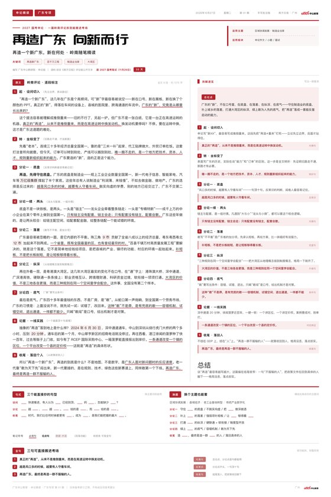

# 申论日报 · 一页纸排版技能

一份 `content.json` 进，**矢量 PDF + 高清长图** 出。页面自动铺满，绝不溢出。

两种模板、同一套视觉：**精读版**把一篇时评拆成双栏批注，**早报版**把一天要闻扫一遍。
整页只有一个强调色 `#B2222C`，其余层级全靠字号、字重、灰度拉开。

<p>
  
  
</p>

---

## 一、两种模板

| | **申论精读**（`daily`，默认） | **申论早报**（`brief`） |
|---|---|---|
| 干什么 | 一篇评论拆到底 | 一天要闻扫一遍 |
| 左栏 | 原文逐段标注：编号 + 功能标签 + 红下划线必背句 | 今日时政 5 条，逐条标考点 |
| 右栏 | 拆解速览：逐条拆写法 + 可背金句 | 会议要点 + 广东/大湾区素材 |
| 底部 | 句式 / 换题 / 金句 | 今日金句 / 数字速记 |
| 基准字号 | 约 6pt（字多） | 约 9—10pt（字少） |
| 一期字数 | 原文 1200—1500 字 | 时政摘要 450—1200 字 |

两者共用同一套版式引擎：同一份 `style.css`、同一个自适应算法、同一套交付规则。
切换只靠 `content.json` 里一个字段：`"template": "brief"`（省略或写 `daily` 即精读版）。

---

## 二、产出物

跑一次，自动新建一个期文件夹，里面**只有**两样：

```
2026广东申论日报-第01期-再造广东向新而行/
├── 申论日报-第01期-再造广东向新而行.pdf     ← 矢量，可打印、可检索
└── 申论日报-第01期-再造广东向新而行.png     ← 1600×2401，小红书用
```

- 文件夹名 = `file_stem`（`年份 + 地区 + 系列 + 期号 + 标题`）
- 文件名 = `file_name`（省略则同 `file_stem`）
- 同名重跑**覆盖**，不会堆出 `(1)` `(2)`；上一轮残留的 html 自动清掉

实测规格（本机 Apple silicon，示例 JSON 原样跑）：

| | 精读版（2:3） | 早报版（2:3） | 早报版（a4） |
|---|---|---|---|
| 页面 | 210×315mm | 210×315mm | 210×297mm |
| 基准字号 | 2.14mm ≈ 6.1pt | 3.25mm ≈ 9.2pt | 3.04mm ≈ 8.6pt |
| 填充率 | 99%（左 98% / 右 99%） | 98%（左 98% / 右 96%） | 100%（左 100% / 右 92%） |
| PNG | 1600×2401 | 1600×2401 | 1080×1528 |
| PDF | 1.29 MB，可检索 3448 字 | — | 1.16 MB，可检索 2335 字 |

---

## 三、目录结构

```
slrbjnb-hwq-gd/
├── README.md                  ← 本文件
├── LICENSE                    ← MIT + 商标/字体/示例内容附加说明
├── CHANGELOG.md               ← 版本记录 + 已知约束 + 相对原包的改动清单
├── requirements.txt           ← 依赖清单（含可选依赖说明）
├── 安装说明.md                 ← 面向使用者的安装 / 排错手册
├── preview-1-精读版.jpg        ← 效果图
├── preview-2-早报版.jpg        ← 效果图
└── shenlun-daily/             ← 技能本体
    ├── SKILL.md               ← 怎么跑（264 行）
    ├── references/
    │   ├── DESIGN.md          ← 版式规范：色板、字级阶梯、五个毛病与改法、自适应算法（202 行）
    │   ├── CONTENT.md         ← 精读版：九段骨架、标签词表、标记语法、字数配额（125 行）
    │   └── BRIEF.md           ← 早报版：取材口径、版式配额、各类条目写法（96 行）
    ├── scripts/
    │   ├── build.py           ← 主入口：渲染 + 自适应 + 出厂自检（544 行）
    │   └── style.css          ← 版式样式，改版式只动这里（272 行）
    ├── assets/
    │   └── offcn.png          ← 报头 / 页脚标识（128 KB，可替换或置空）
    └── examples/
        ├── 2026-10-27-再造广东向新而行.json       ← 精读版样例
        └── 2026-10-27-早报-自我革命永葆清醒.json   ← 早报版样例
```

装到 `~/.workbuddy-ai/skills/` 之后，技能目录即 `shenlun-daily/` 这一层。

---

## 四、环境要求

| 项 | 要求 |
|---|---|
| Python | 3.10+（用了 f-string、`asyncio.run`、类型注解之外的现代语法） |
| playwright | ≥ 1.40，**必需** —— 无头 Chromium 负责排版与导出 |
| Chromium | 由 `playwright install chromium` 安装（约 150 MB） |
| pillow | ≥ 9.0，**必需** —— 长图缩放 |
| pymupdf | 可选 —— 只在自己校验 PDF 时用，`build.py` 不 import |
| 字体 | 正文 `PingFang SC`（macOS 自带）；标题 `庞门正道标题体`（可选，缺了自动回落） |

**字体是这套版式唯一的硬环境依赖**，两条红线写在 `DESIGN.md` 第五节：

1. **正文别用宋体。** Chromium 下 Songti SC 会出字体映射损坏（乱码 `ÆÓØÜÝâåæìíîô÷üýÿ`）。
2. **PingFang 导 PDF 会变成 Type3 字形。** 打印、放大、检索都不受影响，代价是单页 PDF 约 1.3 MB。
   要真字体嵌入，在 `content.json` 里设 `"font_body": "方正黑体简体"`（需自行取得字体授权）。

---

## 五、安装

```bash
# 1) 放进技能目录（注意是 .workbuddy-ai，不是老的 .workbuddy）
mkdir -p ~/.workbuddy-ai/skills
cp -r shenlun-daily ~/.workbuddy-ai/skills/

# 2) 装依赖（建议用虚拟环境，别污染系统 Python）
PY=python3
$PY -m pip install -r requirements.txt
$PY -m playwright install chromium

# 3) 冒烟测试：拿样例跑一遍，应看到「全部通过」+ 两栏 ≥95%
$PY ~/.workbuddy-ai/skills/shenlun-daily/scripts/build.py \
    ~/.workbuddy-ai/skills/shenlun-daily/examples/2026-10-27-再造广东向新而行.json \
    -o /tmp/shenlun-test
```

`安装说明.md` 里有更细的手动安装步骤和排错表（症状 → 原因 → 处理）。

---

## 六、快速开始

```bash
PY=python3

# 精读版：在当前目录自动新建一期文件夹，产出 PDF + 1600px 高清 PNG
$PY ~/.workbuddy-ai/skills/shenlun-daily/scripts/build.py content.json

# 指定输出根目录
$PY ~/.workbuddy-ai/skills/shenlun-daily/scripts/build.py content.json -o ~/工作空间

# 早报版：content.json 里写 "template": "brief"
$PY ~/.workbuddy-ai/skills/shenlun-daily/scripts/build.py 早报.json -o ~/工作空间
```

### 参数

| 参数 | 默认 | 说明 |
|---|---|---|
| `content` | — | 位置参数，`content.json` 路径 |
| `-o` / `--outdir` | `.` | **输出根目录**（不是期文件夹）。脚本会在其中按 `file_stem` 自动新建一期文件夹 |
| `--ratio` | `2:3` | `2:3`（210×315，小红书长图）｜`a4`（210×297）｜`3:4`（210×280） |
| `--px` | `1600` | PNG 宽度。`1600` 高清｜`2400` 印刷级｜`1080` 小红书标准宽｜`0` 不缩放（1903px） |
| `--flat` | 关 | 不建子文件夹，直接输出到 `-o` 目录 |
| `--no-pdf` / `--no-png` | 关 | 只出一种 |
| `--keep-html` | 关 | 保留中间 HTML，改版式时用 |

### 跑完看什么

```
── 出厂自检 ──
  ✓ 结构 · 原文段数：9 段
  ✓ 一致性 · 右栏金句出自原文：全部命中
  ✓ 编号 · 段落 1..N 连续：是
  ...
[版式] 210×315mm  基准字号 2.14mm ≈ 6.1pt  填充率 99%  左栏 98% / 右栏 99%
[PNG] …/申论日报-第01期-再造广东向新而行.png  1600×2401
[PDF] …/申论日报-第01期-再造广东向新而行.pdf
[交付] …/2026广东申论日报-第01期-再造广东向新而行
```

**只看两行**：自检有没有 `✗`；左右栏百分比是不是都在 95% 以上。
某栏低于 85% → 那一栏补两三行。自检有 `✗` → 按提示改内容，**不要改脚本**。

---

## 七、content.json 字段

### 7.1 精读版

```jsonc
{
  "file_stem": "2026广东申论日报-第02期-xxx",   // 期文件夹名
  "file_name": "申论日报-第02期-xxx",           // 文件名（不含扩展名），省略则同 file_stem
  "meta": {
    "brand": ["申论精读", "广东专项"],          // 左上角色块
    "date": "2026年10月27日", "weekday": "星期二",
    "issue": "第 01 期", "edition": "手写批注版",
    "source": "南方日报 · 广州", "city": "广州",
    "logo": "offcn"                             // assets/ 下的文件名，省略=不显示
  },
  "head": {
    "kicker": "2027 国考申论 · 一句话题眼",
    "title": "再造广东 向新而行",               // 6—10 字，超 12 字会换行
    "subtitle": "再造一个新广东，新在何处 · 岭南随笔精读",
    "keywords": ["再造新广东", "百千万工程"],     // 3—5 个
    "credit": "编写 …　|　语料 …",
    "countdown": { "label": "距 2027 国考笔试（11月29日）", "days": "33 天" },
    "fit": [ { "k": "适用主题", "v": "区域协调发展 · 制造业当家" } ]
  },
  "left": {
    "tag": "原文", "title": "岭南评论 · 逐段标注", "note": "",
    "paras": [ { "no": 1, "tag": "起 · 设问切入", "note": "先立边界，再谈路径",
                 "text": "正文…**段首论点句**…==必背句==…^^数据^^\n第二自然段…" } ]
  },
  "right": {
    "tag": "拆解速览", "title": "", "note": "写法一眼看清",
    "thesis": "总论点，80—110 字",
    "items": [ { "no": 1, "tag": "起 · 设问切入",
                 "analysis": "一句话点破手法，30—45 字",
                 "quote": "从该段 == 句里取一句", "func": "对偶句" } ],
    "summary": "50—70 字，只说这篇收尾为什么好"
  },
  "bottom": {
    "patterns": { "tag": "句式", "rows": [ { "k": "设问", "v": "____ 快速推进…" } ] },
    "remap":    { "tag": "换题", "topics": ["区域协调发展"], "rows": [ { "k": "分论一", "v": "…" } ] },
    "gold":     { "tag": "金句", "rows": [ { "no": 1, "text": "…", "func": "对偶句", "use": "…" } ] },
    "legend_title": "笔记符号",
    "legend": ["==必背句==", "**论点句**", "^^数据·术语^^", "〔段落功能〕", "粉底条 可背金句"]
  },
  "footer": { "left": "…　|　仅供备考研习之用", "city": "广州" }
}
```

### 7.2 早报版

```jsonc
{
  "template": "brief",
  "file_stem": "2026广东申论早报-第001期-xxx",
  "file_name": "申论早报-第001期-xxx",
  "meta": { "brand": ["申论早报", "广东专项"], "issue": "第 001 期", "edition": "时政速览版" },
  "head": { "title": "自我革命 永葆清醒", "keywords": ["…"], "countdown": { … }, "fit": [ … ] },
  "news":     { "items": [ { "no": 1, "dom": "中央 · 会议", "title": "≤24 字",
                             "text": "100—120 字，含 ==规范表述==", "point": "40—55 字，怎么用" } ] },
  "meetings": { "items": [ { "no": 1, "name": "…", "when": "10.26—10.29",
                             "points": ["议程：… [[关键表述]] …"] } ] },
  "region":   { "items": [ { "no": 1, "tag": "产业", "text": "60—90 字，带 ==数字==" } ] },
  "bottom": {
    "gold":    { "rows": [ { "no": 1, "text": "…", "use": "放作文哪个位置" } ] },
    "figures": { "items": [ { "k": "…增速", "v": "41.4%" } ] }
  }
}
```

### 7.3 正文标记

| 标记 | 渲染 | 用在哪 |
|---|---|---|
| `**文字**` | 加粗 | 段首论点句，一段最多一处 |
| `==文字==` | 红色下划线 | **必背句**，一段 1—2 处，必须是完整能背的句子 |
| `^^文字^^` | 淡红底 | 数据、术语 |
| `[[文字]]` | 深红加粗 | 早报「会议·文件」的关键表述 |
| `___` | 填空线 | 句式 / 换题模板；下划线越多线越长（2 个 ≈ 1 字） |
| `\n` | 分段 | 一段里想分两个自然段时用，各自首行缩进 |

---

## 八、出厂自检

`build.py` 在渲染前先跑自检，把结果打成表。**自检不过不会阻断出图**，所以必须看这张表。

**精读版 8 项**

| 项 | 判据 |
|---|---|
| 结构 · 原文段数 | ≥ 6 段 |
| 结构 · 拆解条数 | 与原文段数相等 |
| 结构 · 金句 | 2—4 句 |
| 一致性 · 右栏金句出自原文 | 拿 `quote` 前 10 字在左栏正文做子串比对，全部命中 |
| 一致性 · 金句带出自原文 | 同上 |
| 编号 · 段落 1..N 连续 | 是 |
| 模板 · 句式填空位数 | ≥ 3 处 |
| 篇幅 · 原文总字数 | 800—2200 字 |

**早报版 9 项**：时政 3—6 条 / 每条齐 `dom`+`title`+`text`+`point` / 标题 ≤24 字 /
会议 ≥1 个且每个 ≥2 条要点 / 广东 ≥3 条 / 金句 1—3 句 / 数字 4—8 个 / 编号连续 /
时政摘要总字数 450—1200。

> 「一致性」那一项是这套版式最值钱的一条自检。原稿第 7 条金句在正文里**一字不见**，
> 就是它抓出来的。造金句是最容易犯、也最难看出的错——读者不会逐字去核，机器会。

---

## 九、版式体系

改版式只动 `scripts/style.css`。三条纪律：

1. **单位一律 mm，字号一律 `calc(var(--fs) * 倍率)`。** 写死 px/pt 会让自适应失效。
2. **整页只有一个强调色。** 红色只出现在四处且面积递减：报头色块 → 段落编号方块 →
   区块标签 → 细下划线与细线。层级靠字号 / 字重 / 灰度，不靠第二种颜色。
3. **字号只有 6 档，相邻两档至少差 12%。** 差 2%—3% 的档位在 6pt 的字上肉眼分不出来，等于没有层级。

| 档 | 倍率 | 用在哪 |
|---|---|---|
| 主标题 | 4.30× | 标题体，`line-height:1.02` |
| 副标题 | 1.22× | 600 字重 |
| **正文** | **1.00×** | `line-height:1.74`，两端对齐，首行缩进 2em |
| 段落标签 | 0.94× | 600 字重 |
| 右栏解析 | 0.84× | 灰色，`line-height:1.64` |
| 批注 / 署名 | 0.72× | 更浅一档 |

### 自动铺满算法

一页纸最怕两件事：**溢出**（字被切掉）和**留白**（半页空着）。手工调字号必然反复。

`build.py` 的做法：在 `[2.0mm, 4.8mm]` 区间对 `--fs` 二分 16 轮，每轮量 `#colL .inner`
与 `#colR .inner` 的真实高度，取大者与 `#cols` 可用高度比，取「刚好放得下」的最大值。

一个关键细节（踩过）：**不能用 `scrollHeight` 量高度。** 父元素 `overflow:hidden`
且内容比容器矮时，`scrollHeight` 恒等于 `clientHeight`，判定永远"刚好满"，
字号会被锁死在最小值。必须量子元素 `getBoundingClientRect().height`。

---

## 十、已知约束

| # | 约束 | 说明 / 规避 |
|---|---|---|
| 1 | **`--ratio 3:4` 下精读版会溢出** | 实测示例（原文 1376 字）在 210×280mm 上填充率 109%、左栏 107%，字号已压到下限 2.00mm 仍差 57px。脚本会在 stderr 打 `[!] 内容溢出`，但**仍会出图**（底部被切）。→ 精读版用默认 `2:3` 或 `a4`；坚持 3:4 就删到 1100 字以内 |
| 2 | **自检不过不阻断出图** | 自检 `✗` 只打印，退出码仍为 0，图照出。→ 每次都要看自检表，别只看「交付」那行 |
| 3 | PingFang 导 PDF 变 Type3 | 打印 / 放大 / 检索都正常，单页 PDF 约 1.3 MB。要真字体嵌入见第四节 |
| 4 | 标题字体需自备 | 缺「庞门正道标题体」时回落 `Hiragino Sans GB` → `PingFang SC`，版式不变但观感不同 |
| 5 | 早报时政一条都不许编 | 会议名、文件全称、数字、时间必须能追到来源。检索不到就当天空缺，宁可少一条 |
| 6 | 一期一文件夹 | `-o` 是**输出根目录**不是期文件夹，脚本自己在里面建文件夹；`--flat` 才会平铺 |

---

## 十一、常见问题

| 症状 | 原因 | 处理 |
|---|---|---|
| 技能列表里找不到 | 装到 `~/.workbuddy/skills/` 了 | 挪到 `~/.workbuddy-ai/skills/` |
| `ModuleNotFoundError: playwright` | 依赖装到别的解释器了 | 用跑 `build.py` 的那个解释器 `-m pip install` |
| 中文显示成方块 | 机器没有 PingFang SC | 装苹方，或在 `content.json` 里设 `font_body` |
| 主标题不是那个粗黑体 | 缺庞门正道标题体 | 装字体，或设 `font_head` 换别的标题体 |
| 内容被切掉 | 字太多，压到最小字号还放不下 | 看 `[!] 内容溢出 …px`，删减文字 |
| 页面下半页空着 | 字太少 | 看 `[!] 填充率仅 …`，补 3—5 行 |
| 导出 PDF 里中文选不中 | 正常，PingFang 转成了 Type3 | 不影响打印；要真字体见第四节 |
| 自检报「右栏金句未命中」 | 金句不是从原文 `==…==` 句里取的 | 回到左栏挑一句原样的，别自己造句 |

---

## 十二、相对原包的改动

发布时对原始技能包**改动了 4 个文件、共 7 处**，其余 8 个文件逐字节一致（MD5 逐一比对）：

| 文件 | 改了什么 | 为什么 |
|---|---|---|
| `scripts/build.py` | docstring 里写死的本机解释器绝对路径 → `python3` | 别人机器上照抄必失败，且暴露本机用户名 |
| `SKILL.md` | 同上（`PY=` 那一行） | 同上 |
| `安装说明.md` | 同上（2 处）＋ `pymupdf` 依赖标记由「必需」改为「可选」 | 同上；`build.py` 实际不 import pymupdf |
| `references/DESIGN.md` | 实测百分比 `97% / 100%` → `98% / 99%` | 与同文件第二节及实跑结果不一致，属笔误 |
| `SKILL.md` | 标记清单补上 `[[深红加粗]]` | `build.py` 支持、`BRIEF.md` 在用，原清单漏列 |

渲染逻辑、版式参数、字号阶梯**一行未动**。

---

## 十三、许可证

MIT，见 [LICENSE](LICENSE)。

代码与文档可自由使用、修改、分发。以下**不在授权范围**内，二次分发前请处理：
`assets/offcn.png` 的商标权、文档中提及的商业字体、`examples/` 里的示例内容。
